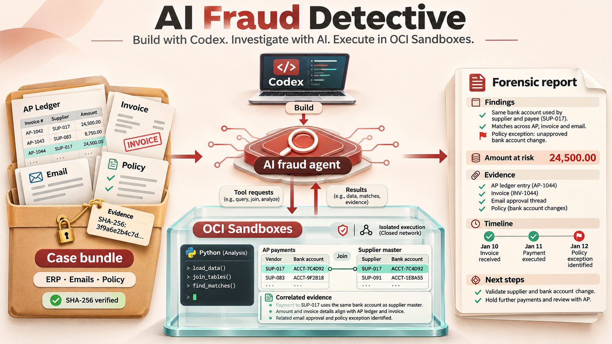

# AI Fraud Detective

[](https://black.readthedocs.io/)
[](https://pylint.readthedocs.io/)
[](https://docs.pytest.org/)
[](https://www.python.org/downloads/)



Most payment fraud is not hidden in a single document. It shows up in the
connections across systems: a supplier's bank account that was changed
without verification, invoices that stay just under an approval threshold,
and a clerk who can both enter and approve them.

In this workshop, you will use **Codex** to build an AI agent that
investigates an **accounts payable data bundle**, an archive of ERP exports,
emails and control policies. The agent produces a forensic report with
findings, the amount at risk, cited evidence, a timeline and next steps.

You will learn how to give a model tools to explore files, run Python
analysis and correlate evidence across tables, logs and emails.

You will also learn how to manage an investigation across multiple steps with
the **OpenAI** Responses API and turn its findings into a structured report
with verifiable citations.

The model writes and runs analysis code that nobody has reviewed, on
financial and personal data. To contain that execution and keep the data
inside, all analysis runs in an isolated **OCI Sandbox with outbound network
access disabled**.

The model runs through OCI Generative AI or **OpenAI**. OCI provides the
sandbox in either case.

Follow Labs 0–3 in order. Allow about **40–60 minutes**, including time to read
the guides and review the generated code. Sandbox creation may occasionally
take longer. The [lab overview](docs/lab-overview.md) explains what you
will learn in each lab.

| Lab | Guide | You work on |
|-----|-------|-------------|
| 0 | [Setup and preflight](labs/lab0.md) | Environment, OCI project and configuration |
| 1 | [Sandbox tools](labs/lab1.md) | `fraud_detective/tools.py` |
| 2 | [Agent loop](labs/lab2.md) | `fraud_detective/agent.py` |
| 3 | [Report and end-to-end run](labs/lab3.md) | `fraud_detective/report.py`, `fraud_detective/cli.py` |

## The case

Halden Manufacturing, a fictitious industrial company, receives an anonymous
report: *someone in accounts payable may be diverting supplier payments*. The
report names no person and no supplier. Because the suspicion is internal,
management engages an external forensic firm instead of asking the finance
department to investigate itself.

You play the analysts of the forensic firm:

1. The firm defined the extraction procedure and script. The internal IT
   team, which does not report to finance, approved them and ran the
   extraction without notice, with a read-only database user.
2. The script produced the bundle with a manifest of file hashes, and
   recorded the SHA-256 of the whole archive outside it, in the case file.
3. Your agent verifies that hash before the investigation, then explores
   nine months of payables data: suppliers, bank accounts, change logs,
   invoices, payments, employees, user roles and emails.
4. Its report cites the exact rows that support each finding and states the
   hash of the bundle it analysed. The investigators verify it before
   drawing conclusions.

All data in the sample case is invented: company, people, suppliers and
bank accounts.

### Why a sandbox, if the data is intact?

- **The code is untrusted.** The model writes and runs Python that nobody
  reviewed. A bug or a wrong command must not run where there is access to
  the ERP, to credentials or to other data, even when the bundle is clean.
- **The data is sensitive.** Supplier and payroll bank details, employee
  records: with outbound traffic denied, not even a model error can send
  them anywhere.
- **Integrity is not trust.** The hash proves that nobody changed the data
  after the extraction, not who wrote it. Invoice descriptions and emails
  come from suppliers, and the rows under investigation were entered by the
  suspect. Some of that text tries to manipulate the AI.

## Before you start

Have these ready:

- Git, Codex, and either Conda or an installed Python interpreter for `venv`.
  The commands below use Conda to create a Python 3.12 environment; the
  [venv setup guide](docs/setup-venv.md) provides the alternative walkthrough.
- Access to an OCI tenancy and a compartment where you can create Generative AI
  projects and sandboxes. Ask your tenancy administrator for the required permissions.
- The OCI CLI installed and OCI credentials configured in `~/.oci/config`.
- An OCI Generative AI API key, or an OpenAI API key if you use OpenAI for the model.

**You need OCI for the sandboxes even when the model provider is OpenAI.**
See [Lab 0](labs/lab0.md) for the project settings, concepts and troubleshooting.

## Quick start: prepare for the labs

Run the commands below **one at a time**. Complete each step before moving on.
If you already have this repository on your machine, start by opening its root
directory and skip the clone command.

**Prefer Python venv?** Follow the [step-by-step venv setup guide](docs/setup-venv.md)
instead of this Conda walkthrough. It covers the environment, dependencies,
OCI configuration and preflight checks, then brings you back to the labs.

### 1. Get the workshop files

Clone the repository:

```bash
git clone https://github.com/luigisaetta/ai-fraud-detective.git
```

Enter the cloned directory. Run all subsequent commands from here:

```bash
cd ai-fraud-detective
```

### 2. Create and activate the Python environment

Create a dedicated environment with Python 3.12:

```bash
conda create -n ai-fraud-detective python=3.12 -y
```

Activate it so the following commands use that environment's Python. Repeat
this activation whenever you open a new terminal for the workshop:

```bash
conda activate ai-fraud-detective
```

### 3. Install the dependencies

Install both the application packages and the tools used to test and check your
code. Wait for the installation to finish successfully:

```bash
python -m pip install -r requirements.txt -r requirements-dev.txt
```

### 4. Create the OCI Generative AI project

The project holds the conversations and sandboxes used by the agent. The files
in `config/` enable server-side conversations, short-term memory and sandboxes
with outbound traffic denied.

Replace `YOUR_COMPARTMENT_OCID` with your compartment OCID, then run this single
command. The backslashes continue it across lines:

```bash
oci generative-ai generative-ai-project create \
  --compartment-id YOUR_COMPARTMENT_OCID \
  --display-name fraud-detective \
  --conversation-config file://config/project-conversation.json \
  --short-term-memory-optimization-config file://config/project-short-term-memory.json \
  --sandbox-config file://config/sandbox-project-deny-all.json
```

Save the **project OCID** returned by the command: you need it in the next step.
You can instead create the project in the OCI Console by following
[Lab 0, step 2](labs/lab0.md#2-create-the-generative-ai-project). If you already
have a project, check that it has the settings described there before reusing it.

### 5. Configure the API key and the agent

Create your local secrets file from the example. Run this only if you do not
already have a `.env` file, so you preserve any existing credentials:

```bash
cp .env.example .env
```

Open `.env` in your editor and set `OCI_GENAI_API_KEY`, or `OPENAI_API_KEY` if
your model provider is OpenAI. Keep API keys in this file and never commit it.

Then open `config/settings.toml` and fill in the configuration:

| Section | What to set |
|---------|-------------|
| `[model]` | `provider` (`oci` or `openai`) and `model_id` |
| `[oci]` | `region`, the new `project_id`, and your OCI SDK `profile` and `auth` |
| `[sandbox]` | Keep the workshop defaults to start with |

The OCI region and credential profile must match the project you will use.
[Lab 0, step 3](labs/lab0.md#3-configure-the-agent) provides more context.

### 6. Check the configuration and model

Run the quick preflight. It checks your local environment, configuration, OCI
credentials, project, permissions and model tool calling. It calls the model
but **does not create a sandbox**:

```bash
python -m fraud_detective.preflight --quick
```

If a check fails, follow the hint printed below it, fix the problem and rerun
the same command before continuing.

### 7. Check the sandbox

Run the full preflight to create a test sandbox, check its tools and file
transfer, verify network isolation, and clean it up:

```bash
python -m fraud_detective.preflight
```

Under normal conditions, sandbox creation and deletion together take less
than 20 seconds. Creation may occasionally take several minutes; the preflight
shows progress while you wait. You can read the Lab 1 guide in the meantime.

Continue when the checks pass. A warning that cleanup is still waiting for the
sandbox to stop is acceptable: delete it later with
`python -m fraud_detective.cleanup --delete`.

## Work through Labs 1–3

Start with the [Lab 1 guide](labs/lab1.md), then continue with
[Lab 2](labs/lab2.md) and [Lab 3](labs/lab3.md). In each lab:

1. Read the guide to understand the module and its interfaces.
2. Give Codex the lab's prompt from `prompts/`, as directed by the guide.
3. Review the generated code and run the acceptance tests.
4. Continue when the checks pass; the next lab builds on your work.

Read [AGENTS.md](AGENTS.md) so you know the repository rules Codex follows.
You will create the lab modules in `fraud_detective/` as you complete Labs 1–3.
Reference implementations are available in `solutions/` for comparison or to
catch up.

For example, after Lab 1, run its acceptance tests together with the tests of
the provided infrastructure. These tests use fakes and make no OCI or model calls:

```bash
python -m pytest tests/unit tests/lab1 -q
```

For later labs, run the test command in that lab's guide. Check formatting with:

```bash
python -m black --check fraud_detective tests
```

Then check the Python code for lint problems:

```bash
python -m pylint fraud_detective
```

## Run your finished agent

After completing Lab 3, generate the sample case:

```bash
python -m fraud_detective.make_bundle
```

This creates the bundle `bundles/halden-ap-q3-2026.zip` and, next to it, the
reference hash recorded in the case file, `bundles/halden-ap-q3-2026.sha256`.
Investigate the bundle with the agent:

```bash
python -m fraud_detective.cli bundles/halden-ap-q3-2026.zip --keep
```

The CLI verifies the bundle against the reference hash, prints each stage
and writes the findings to `out/halden-ap-q3-2026-report.md` and
`out/halden-ap-q3-2026-report.json`. Review the findings, the total exposure
and the evidence verification marks as described in the
[Lab 3 guide](labs/lab3.md).

With `--keep`, the sandbox remains available and the CLI prints its ID and a
command to reuse it. To run another investigation without waiting for a new
sandbox, replace `YOUR_SANDBOX_ID` below with that ID:

```bash
python -m fraud_detective.cli bundles/halden-ap-q3-2026.zip --sandbox-id YOUR_SANDBOX_ID
```

The CLI preserves an attached sandbox. Follow the Lab 3 cleanup instructions
when you finish using it. Omit `--keep` on the first run if you want the CLI
to close the sandbox it creates.

For a map of the project files, see [Repository layout](layout.md).
Instructors find the story, the data and the answer key in the
[scenario design](docs/scenario-design.md); participants should read it only
after their first run, because it reveals the findings.

## How AI is used

The model does much more than write the report: it plans and runs the whole
investigation, choosing tools, writing analysis code and correlating evidence
across files. Read [How AI is used in this project](docs/how-ai-is-used.md)
before choosing a model.

## The easy path

To run the demo without building the code with Codex, copy the reference
solutions into `fraud_detective/` with `./copy_solutions.sh all` and go straight to a
real investigation (see: Lab3). See [The easy path](docs/easy-path.md).

## License

This project is licensed under the [MIT License](LICENSE).
